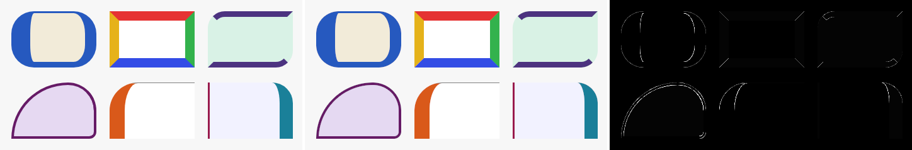

# Styles

How a node's paint (and, from the layout milestone on, its layout) is described: interned
styles applied by ID, per-node overrides, theme tokens, state variants and transitions.
The choices behind it are logged in `docs/decisions.md` (Milestone 2); the byte layout of
every op is below and in `docs/command-buffer.md`.

## Model

A **style** is a list of blocks of declarations, defined once by ID (`define_style`) and
applied to a node by listing IDs (`set_styles`). A block applies when the node has every
state the block requires; the first block usually requires none (the base block).

Every node resolves its values from, lowest precedence first:

1. **Starting values:**
   - inherited properties: the parent's computed value ([Inheritance](#inheritance));
   - every other property: its initial value (transparent background, no border, radius 0,
     opacity 1, no clip, the layout initials in [`docs/layout.md`](layout.md)).
2. **`set_text`'s values**, for a node with text: those of its color, family, size,
   weight, slant, language, line height and alignment it sets itself (`ui_text_desc.set`)
   replace the inherited ones, and its max lines the initial one.
3. **The matching blocks of its styles**, ordered by:
   1. specificity: the number of states a block requires, so base blocks come first;
   2. the style's position in the node's list, so later styles win;
   3. the block's position in its style.

   So a hover block beats every base, a later style's hover beats an earlier style's
   hover, and a hover+pressed block beats any single-state block, whichever style it is
   in. This is how pseudo-class specificity works in CSS.
4. **Per-node overrides** (`set_props`), and `set_color`, `set_corner_radius`, `set_clip`
   (see [Older ops](#older-ops)).

A style ID that isn't defined (yet, or any more) contributes nothing. Redefining a style
resolves every node that lists it again, which is what hot reload needs.

### Inheritance

As in CSS, some properties inherit: a node that doesn't declare one takes its parent's
computed value, and a top-level node takes the surface's.

- **Inherited:** text color, font family, size, weight and slant, language, line height,
  text alignment and direction. Nothing else.
- **At a surface:** initial values. Family: the default (the first registered font's
  family); size 16 px; weight 400; normal slant; no language; line height from the fonts;
  start alignment; opaque black; left to right.
- **`inherit`** works on every property and transition: the parent's computed value, also
  for a property that doesn't inherit (a percentage stays a percentage). A node with such a
  declaration follows every change of its parent.
- **`initial`** works on every property: its initial value, which also resets an inherited
  property for the node's descendants.
- **Minimal work.** A node's values are computed in two steps. Its *cascade* (the entries
  that apply, in order) is gathered again only when its styles, state or overrides change,
  or a style it lists is redefined. Its values are then computed from the cascade and the
  parent's values. A change computes the changed node, then only those children whose
  inherited values change, so it stops wherever descendants declare their own. Nodes are
  computed parents first, in one pass per frame.
- **Moving a node** (`move_node`) computes it again under its new parent.
- **Text shapes with the computed values.** A paragraph's family, size, weight, slant and
  language are its node's computed values, and its direction the node's unless `set_text`
  sets one. A change to any of them, through a style, a token, a state, an override, a
  move or the parent's values, shapes the paragraph again, on the worker threads before the
  change applies ([`docs/text.md`](text.md), "Preparation").
- **`set_text` leaves fields to the node.** `ui_text_desc.set` names the fields `set_text`
  sets itself (`UI_TEXT_SET_*`); the others come from the node. Zero-initialized
  descriptors therefore follow the styles: give a text node a style, or let it inherit from
  its parent. A span's `set` does the same against the paragraph's values, so a span can
  make a word bold and keep the paragraph's size.

### Tokens

A declaration's value can be `token(id)`: the value of theme token `id`, set with
`set_token`. Changing a token resolves every node that uses it again, through styles or
overrides, so switching a theme is one op per token.

- **A token's value** is a length, a percentage, a number, a color, a keyword, a string,
  auto, none, or another token (not `inherit`, `initial` or a spring). Chains resolve when
  used. A string token can theme the font family or language.
- **A declaration counts as absent**, and the next lower declaration shows through, when:
  - its token is missing;
  - the chain loops (Floyd's cycle detection, so a cycle of any length is found);
  - the value is one the property can't take (a length for a color, a negative border
    width).
- **Removing a token** (`set_token` with `unset`) is the same as never defining it.

### States

Each node has 8 state bits; five are named: hover 1, pressed 2, focused 4, disabled 8,
selected 16. Input sets them from milestone 4; until then `set_state(node, mask, value)`
sets the bits in `mask` to those in `value`. A block requiring a state the core doesn't
know yet simply never matches.

### Transitions

A declaration of `transition(P)` with a `spring(stiffness, damping)` value makes property P
animate whenever what it resolves to changes, for any reason: a different style list, a
token, a state, an override, a redefined style, or new text with another color.

- **A running spring retargets and keeps its velocity**, so interrupting it never jumps.
- **A node's first resolution never animates**: new nodes appear at their values.
- **Transitionable properties:** background color, border color, corner radius, opacity
  and text color. Colors spring in linear light.
- **Layout properties don't transition one by one.** `transition(layout)` (property 64)
  animates the node from where it is drawn to wherever layout puts it, whatever moved it
  ([layout animations](layout.md#layout-animations)).
- **`none`** turns a transition off (from a later style or an override).

## Properties

| Id | Property | Values | Initial |
| --- | --- | --- | --- |
| 1 | `background_color` | color | transparent |
| 2 | `border_color` | color: all four sides (shorthand) | transparent |
| 3 | `border_width` | px ≥ 0: all four sides (shorthand) | 0 |
| 4 | `corner_radius` | px ≥ 0: all four corners (shorthand) | 0 |
| 5 | `opacity` | number in [0, 1]: the node and its subtree, as one group | 1 |
| 6 | `clip` | keyword: 0 none, 1 rect (text and descendants inside the node's rect) | 0 |
| 7 | `text_color` (inherited) | color: the text's default style; spans keep their own colors | opaque black |
| 8 | `line_height` (inherited) | number in (0, 100] (× the font size), or auto (from the fonts) | auto |
| 9 | `text_align` (inherited) | keyword: start, end, left, right, center, justify (0–5) | start |
| 10 | `max_lines` | whole number ≤ 65535 (0 = unlimited), or none | none |
| 11 | `font_family` (inherited) | string: a CSS-style family list, e.g. `"Noto Sans, sans-serif"` | the default |
| 12 | `font_size` (inherited) | px in (0, 4096] | 16 |
| 13 | `font_weight` (inherited) | whole number in [1, 1000] | 400 |
| 14 | `font_slant` (inherited) | keyword: normal, italic, oblique (0–2) | normal |
| 15 | `language` (inherited) | string: a BCP 47 tag of at most 64 bytes, or none | none |
| 16 | `direction` (inherited) | keyword: ltr, rtl (0–1) | ltr |
| 17 | `content_animation` | keyword: clip, reflow (0–1): content while a layout animation resizes the node ([`docs/layout.md`](layout.md)) | clip |
| 0x8000 \| P | transition of P | spring, or none | none |

Every property also takes `inherit` and `initial`. `set_text`'s values sit between the
inherited (or initial) value and the styles ([Model](#model)).

Layout properties ([`docs/layout.md`](layout.md)); keywords are the `ui_flex_*`,
`ui_display` and `ui_position` values in `include/ui/wire.h`:

| Id | Property | Values | Initial |
| --- | --- | --- | --- |
| 32 | `display` | keyword: flex, none | flex |
| 33 | `position` | keyword: relative, absolute | relative |
| 34 | `flex_direction` | keyword: row, row-reverse, column, column-reverse | row |
| 35 | `flex_wrap` | keyword: nowrap, wrap, wrap-reverse | nowrap |
| 36 | `justify_content` | keyword: normal, start, end, center, space-between, -around, -evenly | normal (start) |
| 37 | `align_items` | keyword: normal, start, end, center, baseline, stretch | normal (stretch) |
| 38 | `align_self` | keyword: auto, start, end, center, baseline, stretch | auto |
| 39 | `align_content` | keyword: normal, start, end, center, stretch, space-* | normal (stretch) |
| 40, 41 | `flex_grow`, `flex_shrink` | number ≥ 0 | 0, 1 |
| 42 | `flex_basis` | px, percent (≥ 0) or auto | auto |
| 43, 44 | `row_gap`, `column_gap` | px or percent, ≥ 0 | 0 |
| 45, 46 | `width`, `height` (border box) | px or percent (≥ 0), or auto | auto |
| 47, 48 | `min_width`, `min_height` | px or percent (≥ 0), or auto | auto |
| 49, 50 | `max_width`, `max_height` | px or percent (≥ 0), or none | none |
| 51–54 | margins (top, right, bottom, left) | px or percent (may be negative), or auto | 0 |
| 55–58 | padding (top, right, bottom, left) | px or percent, ≥ 0 | 0 |
| 59–62 | insets (top, right, bottom, left) | px or percent (may be negative), or auto | auto |
| 63 | `aspect_ratio` | number > 0 (width / height), or auto | auto |
| 64 | `layout` | the layout rect: not declared, only transitioned (`0x8000 \| 64`) | |
| 80, 81 | `margin_start`, `margin_end` | as margins | (the physical sides) |
| 82, 83 | `padding_start`, `padding_end` | as padding | |
| 84, 85 | `inset_start`, `inset_end` | as insets | |
| 66–69 | `border_{top,right,bottom,left}_width` | px ≥ 0 | 0 |
| 70–73 | `border_{top,right,bottom,left}_color` | color | transparent |
| 74–77 | `corner_radius_{top_left,top_right,bottom_right,bottom_left}` | px ≥ 0 (circular) | 0 |
| 86, 87 | `border_start_width`, `border_end_width` | as border widths | |
| 88, 89 | `border_start_color`, `border_end_color` | as border colors | |
| 90–93 | `corner_radius_{top_start,top_end,bottom_start,bottom_end}` | as corner radii | |

Percentages of padding and margins resolve against the containing block's width, as in
CSS. `border_width` (3) also takes part in layout.

Every value property also accepts `token`. Text properties that change shaping (family,
size, weight, slant, language, direction) reshape the text they reach, on the worker
threads before the change applies (`docs/text.md`); the others never reshape.

### Logical properties

Margins, padding and insets have a start and an end side besides their physical ones.
Writing modes are horizontal, so the block sides are top and bottom; only the inline sides
have logical names.

| Logical | Left-to-right node | Right-to-left node |
| --- | --- | --- |
| `margin_start`, `padding_start`, `inset_start`, `border_start_width`, `border_start_color` | left | right |
| `margin_end`, `padding_end`, `inset_end`, `border_end_width`, `border_end_color` | right | left |
| `corner_radius_top_start`, `corner_radius_bottom_start` | top left, bottom left | top right, bottom right |
| `corner_radius_top_end`, `corner_radius_bottom_end` | top right, bottom right | top left, bottom left |

- **They set the same values as the physical properties.** A node has one left margin,
  whether `margin_left` or `margin_start` set it.
- **The node's own direction maps them** (its computed `direction`, inherited or not), not
  its parent's: in CSS a logical property is relative to the element's writing mode.
- **The later declaration wins**, in cascade order: within a block, the later entry; across
  blocks and overrides, the usual precedence. So `margin_right: 40; margin_start: 10` in a
  right-to-left node gives a right margin of 10, and the reverse order 40.
- **A change of direction maps them again** without gathering the cascade: the computed
  values remember which entry set each side.
- **`inherit` on a logical property** takes the parent's value of the physical side it maps
  to. (CSS takes the parent's logical side, mapped with the parent's direction; the two
  differ only when the parent's direction differs from the node's.)

### Drawing

- **Borders** are drawn inside the node's edge, over the background, which covers the whole
  rect as with CSS `background-clip: border-box`. See [Borders](#borders) for sides and
  corners.
- **Opacity** applies to the node and its subtree as one group: they are drawn into an
  offscreen layer, which is then composited at that opacity, as CSS does. Overlapping
  children inside a group therefore don't show through each other.
  - A node with nothing but a background needs no layer: its alpha is multiplied.
  - Opacity 0 skips the node and its subtree entirely.
- **Snapping:** a box at rest snaps to whole physical pixels, with its origin and its size
  each rounded, so a box never changes size depending on where it sits. A box that is
  moving (its frame or its presentation rect springs), and everything inside it, is drawn
  at its exact position, and snaps again on the frame the spring settles. Text baselines always snap, so moving text
  steps vertically by whole pixels.

## Ops

All are in wire v0. Older readers drop them as unknown ops.

| Opcode | Op | Payload |
| --- | --- | --- |
| 12 | `define_style` | `u32 id` (not 0), `u16 header_bytes` (8), `u16 block_count`, then the blocks |
| 13 | `destroy_style` | `u32 id` |
| 14 | `set_styles` | node, `u16 count` (≤ 255), `u16 header_bytes` (12), `u32 ids[count]` (not 0) |
| 15 | `set_props` | node, `u16 header_bytes` (12), `u16 entry_count`, then the entries |
| 16 | `set_token` | `u32 id` (not 0), then one entry whose property is 0 |
| 17 | `set_state` | node, `u32 mask`, `u32 value` |

A **block** starts with an 8-byte header: `u16 block_bytes` (header included), `u8 states`,
`u8` reserved, `u16 entry_count`, `u16 header_bytes` (8; 0 = 8). Its entries follow at
`header_bytes`.

An **entry** is `u16 property`, `u8 kind`, `u8 words` (its size in 4-byte words, header
included), then the value:

| Kind | Value | Words |
| --- | --- | --- |
| 1 `unset` | none (overrides and tokens only: removes it) | 1 |
| 2 `px`, 3 `percent`, 6 `number` | `f32` | 2 |
| 4 `auto`, 5 `none` | none | 1 |
| 7 `color` | `f32 r, g, b, a`: sRGB, straight alpha, clamped to [0, 1] | 5 |
| 8 `keyword`, 9 `token` | `u32` | 2 |
| 10 `spring` | `f32 stiffness` (> 0), `f32 damping` (≥ 0) | 3 |
| 11 `string` | `u16 length` (1–1014), the UTF-8 bytes (no NUL), zero-padded to the word | 1 + ⌈(2 + length) / 4⌉ |
| 12 `inherit`, 13 `initial` | none | 1 |

- **Newer writers.** A reader skips an entry whose property or kind it doesn't know, using
  `words`, and reads the fields it knows from a longer entry. Blocks and the op headers
  carry their size, so they can grow too.
- **Framing errors** reject the whole buffer: an entry of 0 words or one that runs past its
  block, a block shorter than its header or past the payload, ids or entries past the
  payload.
- **Invalid values** drop the op: a known property with a kind it doesn't take, a value out
  of range, `unset` in a style, a 0 id, a string longer than its entry, empty, with a NUL,
  or not UTF-8. The writer refuses these too (`UI_ERR_INVALID_ARGUMENT`).
- **Strings are interned:** equal strings share one copy, referenced by the entries,
  tokens and nodes that use them, and freed after the frame in which the last reference
  went away.

## Older ops

`set_color`, `set_corner_radius` and `set_clip` set the node's overrides of background
color, corner radius and clip. `start_spring` on color or radius sets the override and
animates toward it with its own spring, whatever the styles declare. Without a declared
transition a `set_*` op jumps and stops a running spring, as it always did; with one, the
change animates like any other. `set_rect` and `start_spring` on the rect are unchanged in
this step (the layout step redefines them).

### Borders

Each side has its own width and color, and each corner its own radius, drawn as CSS
(Backgrounds and Borders 3) draws them:
- **Shorthands:** `border_width`, `border_color` and `corner_radius` set all four at their
  place in the cascade; a later longhand or logical property changes one.
- **Radii that don't fit are scaled down together:** every radius is multiplied by the
  smallest of side length ÷ sum of the two radii on that side, when that is below 1.
- **Inner corners are elliptical:** each inner corner's radius is the outer radius minus
  the adjacent border width, along each axis, so a corner between a thin and a thick side
  is an ellipse. An inner radius larger than its inner side is cut by the other edge.
- **Side colors meet on the corner's diagonal**, the line from the outer corner to the
  inner one, anti-aliased over one pixel. A transparent side shows the background.
- **Widths snap:** at rest a border is a whole number of device pixels, at least one when
  nonzero, and layout uses the snapped width, as browsers do, so a 1 px border is 0.8 px
  of layout at 1.25×. A moving node draws its border unsnapped.
- **Transitions:** `transition(border_color)` animates every side's color (a spring each),
  `transition(corner_radius)` every corner (one spring). The longhands have no transitions
  of their own.
- **Drawing:** a box with one radius, width and color uses the cheap rounded-rect shader
  (`rrect.wgsl`, 64-byte instances), as before; any other goes to `border.wgsl` (128-byte
  instances), which computes the per-corner outer edge, the elliptical inner edge and the
  side of each pixel.

**Compared with Chrome.** `tools/border-compare/compare.py` writes the boxes of the
`paint_border_sides` golden as HTML, screenshots them with the pinned
`chrome-headless-shell` 156.0.8078.80, and puts each next to the golden (Chrome, Axe, and
their difference × 4):

| Scale | Pixels differing by more than 8 levels (of 255) | Largest difference |
| --- | --- | --- |
| 1.0 | 704 of 51,200 (1.38%) | 118 |
| 1.25 | 888 of 80,000 (1.11%) | 114 |
| 1.5 | 1,107 of 115,200 (0.96%) | 121 |

([1.0×](images/border-compare@100.png), [1.25×](images/border-compare@125.png))

The shapes, colors and seams match. The differences are anti-aliasing along curves and
corner seams (one-pixel edges, where Chrome uses Skia's analytic coverage and Axe a
one-pixel distance ramp), plus one or two pixels where an inner curve between a 1 px and a
16 px side ends along the thin side.

## Limitations

- Clipping is rectangular; rounded clips need masks in the layers.
- Layers are drawn again every frame. Caching them comes with damage tracking.
- No z-index: paint order is tree order.
