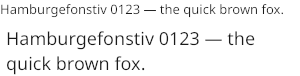
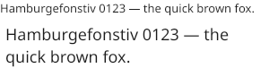
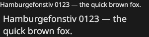
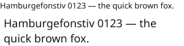

# Text

How Axe turns UTF-8 with style spans into pixels, and how editing will query the result.
The choices behind it are logged in `docs/decisions.md` (Milestone 1); the wire format is
in `docs/command-buffer.md`.

## Pipeline

```
set_text (wire)  ──►  scene node owns a ui_paragraph (text, spans, families, direction)
                         │  core thread, at display-list build time
                         ▼
  shaped paragraph   (cached: text, spans, direction, scale)
     decode UTF-8 ─► bidi levels (UAX #9) ─► script runs (UAX #24)
     ─► grapheme clusters (UAX #29) ─► font per cluster (match + fallback)
     ─► runs where level, script, font or shaping style change ─► HarfBuzz per run
                         │
                         ▼
  line layout        (cached: also width, max lines)
     line breaks (UAX #14 + emergency) ─► pieces per line ─► L1/L2 reorder
     ─► metrics, whole-pixel baselines ─► alignment ─► ellipsis
                         │
                         ▼
  display list       glyph quads (atlas page, texel rect, color) batched with rects
     glyph cache: rasterize on first use (exact-area coverage, 4 subpixel bins)
     atlas update ──(render inbox, FIFO)──► render thread uploads, then draws
```

| Module | Role | Depends on |
| --- | --- | --- |
| `src/unicode/` | UCD 18.0 tables (generated), UTF-8, bidi, line breaking, graphemes, script runs | nothing |
| `src/text/hb/` | faces, sized fonts, shaping, outlines | HarfBuzz (only here) |
| `src/text/fontconfig/` | family matching and coverage fallback on Linux | Fontconfig (only here) |
| `src/text/font_registry.*` | registered faces, CSS-style matching, per-cluster fallback, instance cache | hb, fontconfig modules |
| `src/text/shape.*` | itemization and shaping into a width-independent shaped paragraph | unicode, registry |
| `src/text/paragraph.*` | line layout, ellipsis, the two-level cache | shape |
| `src/text/hittest.*` | point ↔ offset, carets, selections | paragraph |
| `src/text/raster.*` | coverage rasterizer | hb (outlines via a path sink) |
| `src/text/atlas.*` | glyph cache, packing, eviction, upload batches | raster |
| `src/render/shaders/glyph.wgsl` | glyph quads, coverage contrast | — |

## Shaping and fonts

- **Fonts** are registered at app creation (`ui_app_desc.text.font_files`). With
  `system_fonts`, Fontconfig also resolves families and finds fallbacks among installed
  fonts. Tests use only `tests/fonts`.
- **Matching** follows CSS: each entry of a span's family list is tried in turn, choosing
  the closest weight and style. A variable `wght`, `ital` or `slnt` axis is set from the
  span's weight and style. There is no synthetic bold or italic.
- **Fallback** is decided per grapheme cluster. The span's font is used if it covers every
  code point (default-ignorables excepted). Otherwise the first that covers it among the
  family list, registered fonts, and installed fonts. Spaces and punctuation stay in the
  font of the text around them when it covers them, so fallback runs are not split at
  every space.
- **Shaping** happens at the physical size (font size × scale), with grapheme-level
  clusters measured in UTF-8 byte offsets. The whole paragraph is passed as context, so
  joining across runs and across intra-word line breaks is right. There is no hinting.

## Layout

- **Line breaking** is greedy over UAX #14 opportunities. A word wider than the line
  breaks between graphemes. Trailing spaces hang past the line end, so they never cause a
  break.
- **Bidi lines.** Each line is cut into pieces (a shaped run, split again where L1 changes
  the level) and L2 orders the pieces. A piece that begins or ends inside a run is sliced
  when HarfBuzz marks the boundary safe and reshaped otherwise.
- **Metrics.** The line box is `round(ascent + descent + line gap)` over the line's fonts.
  Baselines are whole physical pixels at every scale. Lines align to the start of their
  paragraph's direction.
- **Max lines** cuts the text, and the last kept line ends in an ellipsis (U+2026 by
  default, in the font of the run before it, at the logical end).
- **Caching.** A width change, such as a resize or a spring, only re-breaks lines. A scale
  change reshapes. New text or spans recompute both levels.

## Atlas uploads

The core owns atlas allocation and rasterization; the render thread only uploads and
draws. The difficulty is that display lists reach the render thread through a **mailbox
that may replace** an undrawn list with a newer one. If the glyph texels a list introduced
travelled with that list, a replaced list would take its uploads with it, and a later list
reusing those cached glyphs would draw garbage.

So uploads travel separately:

1. Each core frame that changes the atlas produces one `ui_atlas_update` with an
   increasing `seq`. It carries page creations and releases, plus rectangles of new
   coverage with one pixel blob. It goes into the **render actor's inbox**, an
   **unbounded FIFO** that never refuses, drops or replaces a message.
2. The core pushes the update **before** publishing the frame's display lists, and stamps
   each list with `atlas_seq`, the newest seq pushed. The queue's lock and the mailbox's
   release store make the update visible to whichever thread takes the list.
3. The render actor handles its inbox **only between lists**. After taking a list it
   applies queued updates until it has reached `atlas_seq`, then draws.

An update that belonged to a replaced list is still in the FIFO, so it is applied before
the next list. Every texture write is queued after any draw submitted before it (WebGPU
queue order), so a write never races a draw that is in flight.

**Eviction** frees space for reuse, so it must never overwrite texels a list still to be
drawn will read:

- A glyph is evicted once it has gone unused for `glyph_evict_frames` epochs (default
  300), where an epoch is one core frame that draws.
- A glyph is never evicted if it was last used at or after the **protect epoch**: the
  oldest epoch among the surfaces' newest unfinished lists, which the core knows from the
  render thread's frame-done messages. A replaced list is never drawn, so only the newest
  list of each surface matters.
- Under pressure (no space and no page left to add), unprotected glyphs not used this
  frame are dropped before placement is retried.

`tests/test_atlas_upload.c` checks all of this end to end. Under the single scheduler, a
frame that introduces glyphs is replaced before render runs. Under the threaded scheduler,
a hook holds the render thread while the core publishes 20 frames. In both cases a later
frame reuses the cached glyphs, sends no new upload, and must match a fresh render byte
for byte. Making the render actor keep only the newest queued update, as a mailbox would,
fails both variants.

## Rasterization

Outlines come from HarfBuzz's draw API, at the font's variation instance. Curves are
flattened adaptively to 1/16 px. Every line segment adds its exact signed area to an
accumulation buffer (the trapezoid scheme of font-rs and stb_truetype 2), and a prefix sum
per row gives coverage = min(1, |winding area|). There is no supersampling. Glyphs are
rasterized at one of 4 horizontal subpixel offsets. Baselines are snapped, so there is no
vertical offset.

Pages are 1024² R8 (the page format leaves room for RGBA color glyphs), shelf-packed, up to
8. Glyph quads cover whole pixels and read their texels with `textureLoad`, so there is no
filtering and the output is identical across drivers.

## Coverage contrast

Text blends in linear light, through sRGB targets, like everything else. Linear blending
is physically right, but it makes dark text on light backgrounds look thinner than people
are used to from sRGB-space blending, while light-on-dark text looks heavier. The glyph
shader corrects the coverage:

```
c' = c + k · c · (1 − c) · (1 − L)        L = luminance of the text color
c' = c'^(1/γ)                             optional, γ = 1 (off) by default
```

The `(1 − L)` term makes the boost act on dark text and leave white text alone. k ≤ 1
keeps the curve monotonic. The default **k = 0.9** was measured. For the same coverage,
the total ink of dark-on-light text is:

| k | dark on light |
| --- | --- |
| 0 | 1,346 |
| 0.5 | 1,550 |
| 1.0 | 1,819 |
| sRGB-space blending (reference) | 1,784 |

At k = 0.9 dark text weighs what sRGB blending gives. Light-on-dark text (about 2,000 for
every k) is already that heavy with linear blending. Set k with
`ui_text_config.contrast`, or with `UI_TEXT_CONTRAST` (which can also set 0), and γ with
`gamma` or `UI_TEXT_GAMMA`.

| k | Dark on light | Light on dark |
| --- | --- | --- |
| 0 (linear) |  |  |
| 0.5 |  |  |
| **0.9 (default)** |  |  |
| 1.0 |  |  |

Regenerate the images with
`UI_GPU=software build/debug/tools/text_contrast_shots docs/images`, after building the
`text_contrast_shots` target.

## Hit testing

`src/text/hittest.h` answers the questions editing will ask, in UTF-8 byte offsets:

- **Point to offset with affinity.** The line comes from y, then the grapheme cluster from
  x. The leading half of a cluster (left in LTR, right in RTL) gives its start with
  downstream affinity; the trailing half gives its end with upstream affinity.
- **Offset to caret.** Affinity picks between the two places one offset can be: the end of
  a line or the start of the next at a soft wrap, or the edges of the two runs at a
  direction change.
- **Range to selection rectangles,** per line in visual order, several per line when the
  range crosses a direction change.

Ligatures are split into per-grapheme carets, at GDEF ligature carets when the font has
them and evenly otherwise. The API is internal for now. It becomes public, and
asynchronous for languages, when editing moves into the core.

## Benchmarks

`build/release/bench/bench_text`, on the development machine (AMD Ryzen 5 3400G, GTX 1650, release
build, 2026-11-02):

| Benchmark | Result |
| --- | --- |
| Shaping + layout, 10,028 code points (5 scripts, 150 lines at 1.25×), cold | 7.4 ms |
| Re-layout of the same paragraph at a new width (shaping cached) | 1.2 ms |
| Rasterizing 1,000 new glyphs at 20 px (983 with ink) | 3.5 ms (3.5 µs per glyph) |
| Frame with 2,000 glyphs, 1600×900 px, rebuilt every frame, GTX 1650 | 0.30 ms (core 0.15, encode 0.14) |
| The same frame on lavapipe | 7.6 ms (mostly software rendering) |

## Known limitations

- Start alignment only. Line height comes from font metrics; there is no line-height
  property. HarfBuzz's default language is used; there is no per-span language.
- A fallback font with tall metrics, such as Arabic, makes its lines taller. That is what
  browsers do too, but it shows in mixed paragraphs.
- No clipping: text taller than its node overflows the node.
- No synthetic bold or italic. No color glyphs (the atlas format field is ready for RGBA
  pages). No vertical text, hyphenation or dictionary breaking for Thai, Lao, Khmer and
  Myanmar.
- The first frame that shows new text pays for shaping and rasterization on the core
  thread (about 60 ms for the example's paragraph with five scripts). Pre-warming and
  rasterizing off-thread are future work.
- Fonts are given at app creation; there is no runtime font loading yet.
